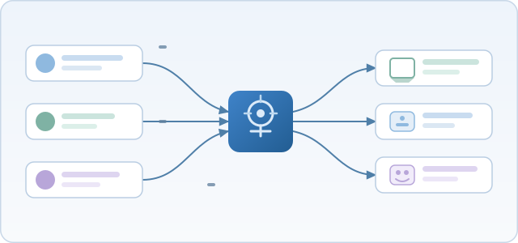

One persona asset set serves the web client and each bot subject. Routing walks subject → private/group channel → target id and falls back at every layer; a disabled layer returns null so the caller can apply its own default.

- **Panel editing** — persona list and body preview, import/delete, web default persona, bot/channel/target bindings; saves go through the host config editor and take effect without restarting.
- **Hot reload** — watches the asset directory and `meta.json`; with watching off, a manual reload clears the cache and rereads the files.
- **Cross-process mirror** — atomically writes `$DSH_HOME/persona-hub/config.json` for a Python gateway to read directly; the web host being offline does not affect the gateway.
- **Identity hint** — switching the web persona sends a role hint to the installed memory hub and silently skips when that plugin is not installed.
- **Local only** — reads local text files, makes no network request, and writes no memory rows.
