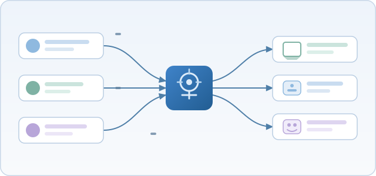

网页端与各平台机器人主体共用一套角色资产；路由按「主体 → 私聊/群聊 → 目标号」逐层回落，任一层关闭即返回 `null`，由调用方兜底。

## 功能

- **面板编辑**：角色列表与正文预览、导入/删除人设、网页端默认角色切换、主体/通道/特例绑定；保存走宿主 configEditor，dsh/bots/panel 即时生效。
- **热重载**：监听资产目录与 `meta.json`（150ms 防抖）；关闭监听后可在面板点「重新加载」清缓存重读，不用重启 DSH。
- **跨进程直读**：原子写 `$DSH_HOME/persona-hub/config.json`，Python 网关直接读配置与人设正文；DSH 不在线也不影响 QQ 端。
- **身份提示**：切网页端角色时给记忆中枢发身份提示（未安装则静默跳过）；不写记忆库。
- **只读本机**：只读本地文本文件，不联网、不写记忆库。

## 安装

插件市场搜索「人设路由中枢 / Persona Routing Hub」（上架后），或装 Release tarball：

```bash
dsh plugin --profile <profile> add <dsh-persona-hub.tgz>
```

开发可用 `link:<本仓目录>`。需要 DSH `>=0.2.2-rc.5 <0.3.0`、Node `>=22.13.0`。

## 使用

1. **网页端**：*角色与资产* → 将某角色设为 DSH 默认（二次确认），或改 DSH 卡片后保存。
2. **机器人主体**：*主体与通道* → 添加主体，设私聊/群聊默认角色，或按目标号绑定；顺序：绑定 → 通道默认 → `null`。
3. **资产**：角色正文为纯 UTF-8 文本，`meta.json` 存显示名/头像；用户副本可导入/删除，出厂角色只读。
4. **调试**：*解析一次* 显示命中角色或 11 条降级原因。
5. **重载**：关闭文件监听时，用面板「重新加载」。

## 配置

`dsh.*`/`bots.*` 即时生效；`assets.dir`/`assets.watch` 需重挂插件；`panel.*` 控制回环访问、刷新间隔与默认页签。完整 15 字段表见 README。

## 独立与共存

记忆中枢是可选服务：所有 `whaleMemory` 调用都做了保护，单装可正常用；共装时人设用 `systemPrompt.section`（`persona-hub:persona`，order 10），记忆用 `systemPrompt.context`（`whale-memory:recall`，order 100），服务名与配置键均不同。人设只发 `roleId`，workspace 仍由会话 cwd 决定。

## 隐私与限制

只读本地文件：不联网、不写记忆库、不接管 QQ 消息流。人设正文上限 200,000 字符；key 必须匹配 `[a-z][a-z0-9_-]{0,31}`。面板 API 默认只允许回环；开放远程前确认网络边界。开源包只带 `bigfish`，其他角色是用户资产。
